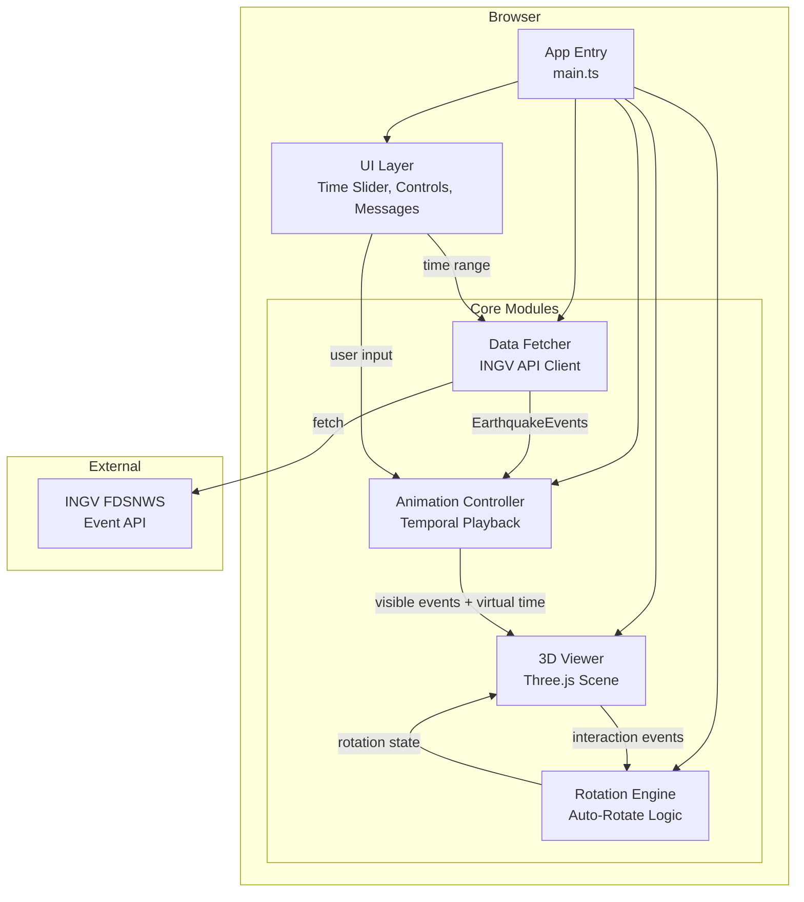

# Design Document: Campi Flegrei 3D Earthquake Visualization

## Overview

Dieses Design beschreibt eine webbasierte Single-Page-Application, die Erdbeben unterhalb der Campi Flegrei als animierte 3D-Punktwolke darstellt. Die Anwendung lädt Erdbebendaten vom INGV FDSNWS Event Service, projiziert sie in eine dreidimensionale Szene und animiert deren zeitlichen Verlauf, während die Szene kontinuierlich um die vertikale Achse des Caldera-Zentrums rotiert.

**Technologie-Stack:**
- **3D-Rendering:** Three.js (r170+) mit WebGL2
- **Sprache:** TypeScript (strikte Typisierung, bessere IDE-Unterstützung)
- **Build-Tool:** Vite (schneller Dev-Server, optimiertes Bundling, native ES-Module)
- **Kein Framework:** Vanilla TypeScript — die Anwendung hat minimalen UI-State und kein Routing
- **Styling:** Minimales CSS, kein Framework nötig

**Begründung der Entscheidungen:**
- Three.js: De-facto-Standard für WebGL im Browser, hervorragende Dokumentation, OrbitControls bietet built-in Auto-Rotation und manuelle Kamerasteuerung
- Vite: Sofortiger HMR, Tree-Shaking für Three.js (nur benötigte Module), kein Webpack-Overhead
- Kein UI-Framework: Weniger als 5 interaktive UI-Elemente (Play/Pause, Slider, Speed-Selector), DOM-Manipulation reicht aus
- TypeScript: Datenmodelle mit Interface-Definitionen, Fehler früh erkennbar

## Architecture



**Datenfluss:**
1. `Data_Fetcher` ruft Erdbebendaten vom INGV-API ab und parst das Pipe-delimited Text-Format
2. Geparste Events werden an den `Animation_Controller` übergeben
3. Der `Animation_Controller` bestimmt anhand der virtuellen Zeit, welche Events sichtbar sind
4. Der `3D_Viewer` rendert die sichtbare Menge als farbkodierte Punkte
5. Die `Rotation_Engine` steuert die automatische Kamerarotation und pausiert bei Benutzerinteraktion

**Modul-Kommunikation:**
Module kommunizieren über ein einfaches Event-basiertes Pattern (TypeScript EventEmitter oder Custom Events). Kein globaler State-Store nötig — der Datenfluss ist unidirektional und überschaubar.

## Components and Interfaces

### Data Fetcher (`src/data-fetcher.ts`)

Verantwortlich für HTTP-Anfragen an den INGV FDSNWS Event Service und Parsing der Antwort.

```typescript
interface FetchOptions {
  startDate: Date;
  endDate: Date;
  minLat?: number;  // default: 40.78
  maxLat?: number;  // default: 40.90
  minLon?: number;  // default: 14.03
  maxLon?: number;  // default: 14.22
  timeoutMs?: number; // default: 15000
}

interface FetchResult {
  events: EarthquakeEvent[];
  warnings: string[];  // malformed records info
}

class DataFetcher {
  fetch(options: FetchOptions): Promise<FetchResult>;
  buildUrl(options: FetchOptions): string;
  parseTextResponse(text: string): FetchResult;
}
```

**INGV API Details:**
- Endpoint: `https://webservices.ingv.it/fdsnws/event/1/query`
- Format: `text` (Pipe-delimited, Header-Zeile beginnt mit `#`)
- Relevante Parameter: `starttime`, `endtime`, `minlat`, `maxlat`, `minlon`, `maxlon`, `format=text`
- Response-Felder: `EventID|Time|Latitude|Longitude|Depth/Km|Author|Catalog|Contributor|ContributorID|MagType|Magnitude|MagAuthor|EventLocationName|EventType`

### 3D Viewer (`src/viewer.ts`)

Verwaltet die Three.js-Szene, Kamera und Rendering-Loop.

```typescript
interface ViewerConfig {
  container: HTMLElement;
  centerLat: number;   // 40.827
  centerLon: number;   // 14.139
  bounds: GeoBounds;
}

interface GeoBounds {
  minLat: number; maxLat: number;
  minLon: number; maxLon: number;
}

class Viewer {
  constructor(config: ViewerConfig);
  
  // Lifecycle
  init(): void;
  dispose(): void;
  
  // Rendering
  updateVisibleEvents(events: VisibleEvent[]): void;
  setDepthScale(minDepth: number, maxDepth: number): void;
  showTooltip(event: EarthquakeEvent, screenPos: Vector2): void;
  hideTooltip(): void;
  
  // State
  getCanvas(): HTMLCanvasElement;
  onInteractionStart(callback: () => void): void;
  onInteractionEnd(callback: () => void): void;
}

interface VisibleEvent {
  event: EarthquakeEvent;
  age: number;          // 0.0 (just appeared) to 1.0 (oldest)
  isNew: boolean;       // highlight effect active
  highlightProgress: number; // 0.0 to 1.0 for fade-out of highlight
}
```

**Szenen-Aufbau:**
- `PerspectiveCamera` mit FOV 60°, initial positioniert mit Blick auf das Caldera-Zentrum
- `AmbientLight` + `DirectionalLight` für sanfte Beleuchtung der Referenzebene
- Referenzebene: halbtransparentes `PlaneGeometry` bei y=0 (Oberfläche)
- Erdbebenpunkte: `InstancedMesh` mit `SphereGeometry` für Performance (bis zu ~1000 gleichzeitige Punkte)
- Tiefenachse: Vertikale Hilfslinien mit Beschriftung (1km, 2km, 3km...)

**Koordinaten-Mapping:**
- Latitude/Longitude → X/Z-Position (lineare Projektion, Zentrum bei 0,0)
- Depth → Y-Position (negativ, nach unten)
- Skalierung: Horizontal ca. 1 Unit = 100m, vertikal dynamisch basierend auf min/max Tiefe

### Animation Controller (`src/animation-controller.ts`)

Steuert die zeitliche Wiedergabe der Erdbebensequenz.

```typescript
interface AnimationConfig {
  events: EarthquakeEvent[];
  defaultDurationSec: number;  // 10-30s for full playback
  speedMultiplier: number;     // 0.25x to 8x
}

type AnimationState = 'playing' | 'paused' | 'stopped';

class AnimationController {
  constructor(config: AnimationConfig);
  
  // Playback
  play(): void;
  pause(): void;
  reset(): void;
  setSpeed(multiplier: number): void;
  
  // State
  getState(): AnimationState;
  getVirtualTime(): Date;
  getProgress(): number;  // 0.0 to 1.0
  
  // Callbacks
  onFrame(callback: (visibleEvents: VisibleEvent[], virtualTime: Date) => void): void;
  
  // Internal
  tick(deltaTime: number): void;
}
```

**Animations-Logik:**
- `virtualTime` bewegt sich linear von `startDate` bis `endDate`
- Geschwindigkeit: `(endDate - startDate) / (defaultDuration / speedMultiplier)`
- Ein Event wird sichtbar, sobald `virtualTime >= event.timestamp`
- Die `age`-Berechnung: `(virtualTime - event.timestamp) / (endDate - startDate)`
- Highlight-Effekt: 0.5s nach Erscheinen (konfigurierbar 0.3–1.0s)

### Rotation Engine (`src/rotation-engine.ts`)

Steuert die automatische Rotation und die Pause bei Benutzerinteraktion.

```typescript
interface RotationConfig {
  degreesPerSecond: number;    // default: 10
  resumeDelayMs: number;       // default: 3000
  easeInDurationMs: number;    // default: 1000
}

class RotationEngine {
  constructor(config: RotationConfig, controls: OrbitControls);
  
  pause(): void;
  resume(): void;
  
  // Called in animation loop
  update(deltaTime: number): void;
  
  // Interaction hooks
  onInteractionStart(): void;
  onInteractionEnd(): void;
}
```

**Implementierung:**
- Nutzt `OrbitControls.autoRotate` und `autoRotateSpeed` von Three.js
- Bei `onInteractionStart`: `autoRotate = false` sofort setzen
- Bei `onInteractionEnd`: Timer starten (3s), dann `autoRotate = true` mit ease-in über `autoRotateSpeed` (0 → Zielwert über 1s)
- `autoRotateSpeed = degreesPerSecond * (2 * Math.PI / 360) / (Math.PI / 180)` → Three.js erwartet Einheit: 2π = volle Rotation bei 60fps

### Time Slider (`src/ui/time-slider.ts`)

UI-Komponente für Zeitraum- und Geschwindigkeitssteuerung.

```typescript
interface TimeSliderConfig {
  container: HTMLElement;
  minDate: Date;       // 2000-01-01
  maxDate: Date;       // heute
  defaultRange: number; // 7 Tage
}

class TimeSlider {
  constructor(config: TimeSliderConfig);
  
  onRangeChange(callback: (start: Date, end: Date) => void): void;
  onSpeedChange(callback: (multiplier: number) => void): void;
  onPlayPause(callback: (playing: boolean) => void): void;
  onReset(callback: () => void): void;
  
  setProgress(progress: number): void;
  setVirtualTime(time: Date): void;
  setLoading(loading: boolean): void;
  showError(message: string): void;
  showWarning(message: string): void;
  showInfo(message: string): void;
}
```

**UI-Elemente:**
- Datumsbereich: Zwei `<input type="date">` für Start/Ende
- Geschwindigkeit: `<select>` mit Optionen 0.25x, 0.5x, 1x, 2x, 4x, 8x
- Playback-Buttons: Play/Pause (Toggle), Reset
- Fortschrittsbalken: `<progress>` oder Custom-Element zeigt aktuelle Position
- Zeitanzeige: `<span>` mit aktuellem virtuellen Datum/Uhrzeit
- Nachrichten-Bereich: Für Fehler, Warnungen und Info-Meldungen

## Data Models

```typescript
/** Ein einzelnes Erdbeben-Event vom INGV API */
interface EarthquakeEvent {
  id: string;           // INGV EventID
  timestamp: Date;      // UTC, Sekundenpräzision
  latitude: number;     // Grad Nord (40.78 - 40.90)
  longitude: number;    // Grad Ost (14.03 - 14.22)
  depth: number;        // km unter Meeresspiegel (positiver Wert)
  magnitude: number;    // Lokale Magnitude / Md
  magnitudeType: string; // z.B. "Md", "ML"
  locationName: string;  // z.B. "Campi Flegrei"
}

/** Darstellungszustand eines Events im 3D-Raum */
interface VisibleEvent {
  event: EarthquakeEvent;
  age: number;              // 0.0 = gerade erschienen, 1.0 = ältestes Event
  isNew: boolean;           // Highlight-Effekt aktiv
  highlightProgress: number; // 0.0 (Start) bis 1.0 (Highlight beendet)
}

/** 3D-Position eines Events in der Szene (berechnete Werte) */
interface ScenePosition {
  x: number;  // longitude → x (zentriert auf Caldera-Mitte)
  y: number;  // depth → y (negativ, nach unten)
  z: number;  // latitude → z (zentriert auf Caldera-Mitte)
}

/** Farbkodierung basierend auf Alter */
interface ColorMapping {
  fresh: THREE.Color;   // Neu: helles Rot/Orange (z.B. #FF4500)
  faded: THREE.Color;   // Alt: gedämpftes Grau/Blau (z.B. #4A6080)
  interpolate(age: number): THREE.Color;  // Linearer Übergang
}

/** Dynamische Tiefenskalierung */
interface DepthScale {
  minDepth: number;     // Minimum aus geladenen Daten (km)
  maxDepth: number;     // Maximum aus geladenen Daten (km)
  sceneMinY: number;    // Untere Grenze der Szene (World Units)
  sceneMaxY: number;    // Obere Grenze (0 = Oberfläche)
  toSceneY(depth: number): number;  // depth → y-Koordinate
}

/** Größen-Mapping basierend auf Magnitude */
interface MagnitudeScale {
  minMag: number;       // 0
  maxMag: number;       // 4
  minRadius: number;    // 2px (screen-projected)
  maxRadius: number;    // 16px (screen-projected)
  toRadius(magnitude: number): number;  // Clamped linear mapping
}

/** INGV API Roh-Datenzeile */
interface RawINGVRecord {
  EventID: string;
  Time: string;
  Latitude: string;
  Longitude: string;
  'Depth/Km': string;
  Author: string;
  Catalog: string;
  Contributor: string;
  ContributorID: string;
  MagType: string;
  Magnitude: string;
  MagAuthor: string;
  EventLocationName: string;
  EventType: string;
}
```

**Dynamische Tiefenachse:**
Die Tiefenachse wird dynamisch skaliert, basierend auf dem tatsächlichen Tiefenbereich der geladenen Daten:
- `sceneMaxY = 0` (Oberfläche, immer fest)
- `sceneMinY` wird berechnet als `-maxDepth * scaleFactor`
- `scaleFactor` wird so gewählt, dass die gesamte Szene gut sichtbar ist (z.B. 1 Scene-Unit = 0.5km)
- Bei sehr flachen Beben (alle < 1km): Mindesttiefe von 2km für die Achse, damit die Szene nicht zu flach wird
- Bei sehr tiefen Beben (> 10km): Achse passt sich an, Skalierung wird ggf. komprimiert

**Farbkodierung während der Animation:**
- `age = 0.0`: Event ist gerade erschienen → `fresh` Color (helles Rot-Orange, #FF4500)
- `age = 1.0`: Event ist das älteste in der Szene → `faded` Color (gedämpftes Blau-Grau, #4A6080)
- Interpolation: HSL-basiert für natürlicheren Farbverlauf (Hue von Orange → Blau, Saturation abnehmen, Lightness abnehmen)
- Highlight bei Erscheinen: Zusätzlicher Glow-Effekt (Scale-Pulse von 1.5x → 1.0x über 0.5s)

## Correctness Properties

*A property is a characteristic or behavior that should hold true across all valid executions of a system — essentially, a formal statement about what the system should do. Properties serve as the bridge between human-readable specifications and machine-verifiable correctness guarantees.*

### Property 1: Parsing Round-Trip Consistency

*For any* valid INGV text response line containing all required fields (EventID, Time, Latitude, Longitude, Depth, Magnitude), parsing the line into an `EarthquakeEvent` and then formatting it back to its constituent values SHALL produce values equivalent to the original input (within floating-point precision).

**Validates: Requirements 1.2**

### Property 2: Bounding Box Filter Integrity

*For any* parsed `EarthquakeEvent`, its latitude SHALL be within [40.78, 40.90] and its longitude SHALL be within [14.03, 14.22], matching the geographic bounding box specified in the API query parameters.

**Validates: Requirements 1.1**

### Property 3: Magnitude-to-Radius Monotonicity and Clamping

*For any* earthquake magnitude value, the computed radius SHALL be monotonically non-decreasing with magnitude. For magnitudes ≤ 0 the radius SHALL be 2px, for magnitudes ≥ 4 the radius SHALL be 16px, and for magnitudes between 0 and 4 the radius SHALL be linearly interpolated.

**Validates: Requirements 2.3, 2.6**

### Property 4: Temporal Color Age Ordering

*For any* two visible events A and B where A appeared before B (A.age > B.age), the color of A SHALL be at least as faded (equal or lower saturation/lightness) as the color of B. The color mapping SHALL be monotonically fading with increasing age.

**Validates: Requirements 2.4**

### Property 5: Chronological Visibility Order

*For any* set of earthquake events and any virtual animation time T, the set of visible events SHALL consist exactly of those events whose timestamp is ≤ T. No event with timestamp > T SHALL be visible, and no event with timestamp ≤ T SHALL be invisible.

**Validates: Requirements 4.1, 4.2, 4.5**

### Property 6: Animation Progress Monotonicity

*For any* sequence of animation ticks while the animation is in 'playing' state, the virtual time SHALL be strictly non-decreasing. The progress value SHALL move from 0.0 toward 1.0 monotonically.

**Validates: Requirements 4.2, 4.3**

### Property 7: Speed Change Preserves Position

*For any* animation state (playing or paused) and any speed change from multiplier A to multiplier B, the current virtual time and set of visible events SHALL remain unchanged immediately after the speed change.

**Validates: Requirements 5.6**

### Property 8: Malformed Record Filtering

*For any* INGV text response containing a mix of valid and malformed lines (missing fields, unparseable numbers, invalid dates), parsing SHALL return exactly the valid records and discard exactly the malformed ones. The count of valid results plus the count of discarded records SHALL equal the total number of non-header lines.

**Validates: Requirements 1.6**

### Property 9: Coordinate Projection Bijectivity and Ordering

*For any* earthquake event within the bounding box, the geo-to-scene coordinate mapping SHALL be injective (no two distinct lat/lon/depth combinations map to the same scene position) and the relative spatial ordering SHALL be preserved (event further east → larger x, event further north → larger z, event deeper → lower y).

**Validates: Requirements 2.1**

## Error Handling

| Szenario | Verhalten | UI-Feedback |
|----------|-----------|-------------|
| INGV API nicht erreichbar / Timeout (15s) | Fetch abbrechen, vorherige Daten behalten | Fehlermeldung: "Daten konnten nicht geladen werden" |
| API Response nicht parsebar | Gesamte Response verwerfen | Fehlermeldung mit Hinweis |
| Einzelne Records malformed | Record überspringen, Rest verwenden | Warnung: "X Einträge konnten nicht verarbeitet werden" |
| Keine Events im Zeitraum | Leere Szene + Referenzebene | Info: "Keine Erdbeben im gewählten Zeitraum gefunden" |
| WebGL nicht verfügbar | Szene nicht initialisieren | Fehlermeldung mit Browser-Empfehlung |
| WebGL Context Lost | Szene-Wiederherstellung versuchen (5s) | Hinweis: "Rendering unterbrochen, Wiederherstellung..." |
| Magnitude außerhalb 0-4 | Clamping auf 0 bzw. 4 für Rendering | Tooltip zeigt Original-Wert |

**Implementierung:**
- Alle API-Fehler werden über `try/catch` mit spezifischen Error-Typen behandelt
- `AbortController` für Timeout-Management bei Fetch-Requests
- WebGL Context Lost/Restored Events: `webglcontextlost` / `webglcontextrestored` EventListener auf Canvas
- Fehler-/Warnungs-Nachrichten werden über die `TimeSlider.showError/showWarning/showInfo` Methoden angezeigt
- Kein unbehandelter Promise-Rejection — alle async Pfade haben Error-Handler

## Testing Strategy

### Unit Tests (Vitest)

- **Data Fetcher Parsing:** Pipe-delimited Text korrekt parsen, malformed Records filtern
- **Coordinate Mapping:** Geo-Koordinaten → Szene-Koordinaten korrekt transformieren
- **Magnitude Scaling:** Clamping und lineare Interpolation
- **Color Interpolation:** HSL-basierter Farbübergang
- **Animation Timing:** Virtuelle Zeit-Berechnung, Speed-Multiplikator
- **URL Builder:** Korrekte INGV API URL-Konstruktion

### Property-Based Tests (fast-check + Vitest)

Bibliothek: [fast-check](https://github.com/dubzzz/fast-check) — die Standard-PBT-Bibliothek für TypeScript/JavaScript.

- **Konfiguration:** Minimum 100 Iterationen pro Property-Test
- **Tag-Format:** `Feature: campi-flegrei-3d-earthquakes, Property {number}: {property_text}`
- Jede der 9 Correctness Properties wird als einzelner Property-Test implementiert
- Generatoren für: `EarthquakeEvent` (mit gültigen Koordinaten im Bounding-Box), INGV-Text-Zeilen (valide und invalide), Magnitude-Werte, Zeitstempel-Sequenzen

### Integration Tests

- **INGV API Mock:** MSW (Mock Service Worker) für realistische API-Antworten
- **Three.js Rendering:** Snapshot-Tests für Szenen-Setup (jest-three oder manuelle Assertions auf Szenen-Graph)
- **End-to-End:** Playwright für Browser-basierte Tests (WebGL-Kontext vorhanden, Szene rendert, Tooltip erscheint)

### Manuelle Tests

- Performance-Überprüfung: 30fps mit 500+ Punkten
- Cross-Browser: Chrome, Firefox, Safari, Edge (letzte 2 Versionen)
- Responsive: 320px bis 3840px Viewport-Breite
- Touch-Interaktion auf Mobilgeräten
