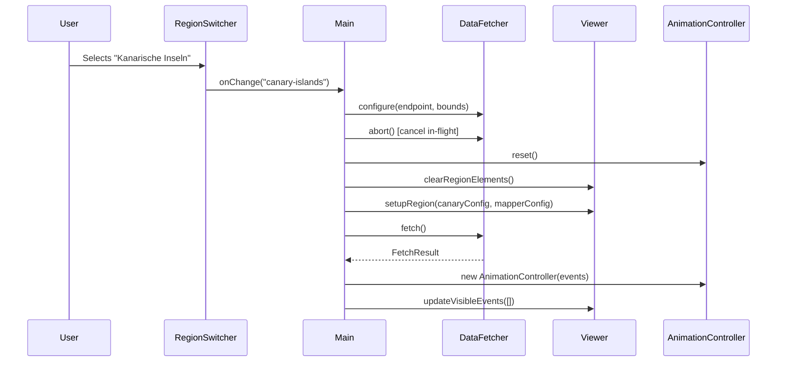

# Design Document: Multi-Region Canary Islands

## Overview

Diese Erweiterung transformiert die bestehende Single-Region-Anwendung (Campi Flegrei) in ein Multi-Region-System. Kernidee: Alle regionsspezifischen Parameter (Zentrum, Bounding Box, Küstenlinie, Städte, API-Endpunkt) werden in ein `RegionConfig`-Interface extrahiert. Bestehende Module (Viewer, CoordinateMapper, DataFetcher, AnimationController) werden parametrisiert statt hardcodiert. Ein Region-Switcher-UI ermöglicht den Wechsel zur Laufzeit.

**Zentrale Design-Entscheidung:** Sowohl INGV als auch EMSC (für die Kanarischen Inseln) verwenden das FDSN-Standard-Textformat (pipe-delimited). Daher wird kein zweiter Parser benötigt — der bestehende `parseTextResponse` funktioniert für beide Endpunkte. Als API-Quelle für die Kanarischen Inseln wird das **EMSC SeismicPortal** verwendet (`http://www.seismicportal.eu/fdsnws/event/1/query`), da IGN Spanien keinen öffentlichen FDSN-Event-Endpunkt exponiert.

## Architecture

```mermaid
graph TD
    subgraph Configuration Layer
        RC[RegionConfig Interface]
        REG[RegionRegistry]
        CF_CFG[Campi Flegrei Config]
        CI_CFG[Canary Islands Config]
    end

    subgraph UI Layer
        RS[RegionSwitcher]
        TS[TimeSlider]
    end

    subgraph Core Modules
        MAIN[main.ts Orchestrator]
        DF[DataFetcher]
        CM[CoordinateMapper]
        V[Viewer]
        AC[AnimationController]
        RE[RotationEngine]
    end

    REG --> CF_CFG
    REG --> CI_CFG
    RS -->|region change event| MAIN
    MAIN -->|active RegionConfig| DF
    MAIN -->|active RegionConfig| CM
    MAIN -->|active RegionConfig| V
    MAIN -->|reset| AC
    TS -->|playback controls| MAIN
    DF -->|EarthquakeEvent[]| AC
    AC -->|VisibleEvent[]| V
    CM -->|geoToScene()| V
```

### Datenfluss bei Regionswechsel

1. User wählt Region im `RegionSwitcher`
2. `main.ts` empfängt Region-ID, holt `RegionConfig` aus `RegionRegistry`
3. `DataFetcher` bricht laufende Requests ab, konfiguriert neuen Endpunkt + Bounds
4. `Viewer` räumt Szene auf (Coastline, Towns, Surface, Punkte), baut neu auf
5. `CoordinateMapper` wird mit neuem Center + Latitude-Faktor parametrisiert
6. `AnimationController` wird resettet, neue Daten werden geladen
7. Kamera wird auf neue Region ausgerichtet

## Components and Interfaces

### RegionConfig Interface

```typescript
// src/region-config.ts

export interface RegionConfig {
  id: string;                        // z.B. "campi-flegrei", "canary-islands"
  title: string;                     // z.B. "Campi Flegrei", "Kanarische Inseln"
  center: { lat: number; lon: number };
  bounds: GeoBounds;
  coastlinePolylines: [number, number][][];  // Array of polylines
  towns: { name: string; lat: number; lon: number }[];
  apiEndpoint: string;               // FDSN event query base URL
  apiFormat: 'fdsn-text';            // Response format identifier
  defaultTimeRangeDays: number;      // Default fetch window
  cameraDistance: number;            // Initial camera distance for framing
}
```

### RegionRegistry

```typescript
// src/region-registry.ts

import type { RegionConfig } from './region-config';

const registry: Map<string, RegionConfig> = new Map();

export function registerRegion(config: RegionConfig): void {
  registry.set(config.id, config);
}

export function getRegion(id: string): RegionConfig | undefined {
  return registry.get(id);
}

export function getAllRegions(): RegionConfig[] {
  return Array.from(registry.values());
}

export function getDefaultRegionId(): string {
  return 'campi-flegrei';
}
```

### Campi Flegrei Config

```typescript
// src/regions/campi-flegrei.ts

import type { RegionConfig } from '../region-config';
import { COASTLINE_POLYLINES } from '../coastline-data';

export const campiFlegrei: RegionConfig = {
  id: 'campi-flegrei',
  title: 'Campi Flegrei',
  center: { lat: 40.827, lon: 14.139 },
  bounds: { minLat: 40.78, maxLat: 40.90, minLon: 14.03, maxLon: 14.22 },
  coastlinePolylines: COASTLINE_POLYLINES,
  towns: [
    { name: 'Pozzuoli', lat: 40.822, lon: 14.122 },
    { name: 'Bacoli', lat: 40.800, lon: 14.070 },
    { name: 'Baia', lat: 40.813, lon: 14.075 },
    { name: 'Quarto', lat: 40.876, lon: 14.145 },
    { name: 'Monte di Procida', lat: 40.798, lon: 14.050 },
    { name: 'Bagnoli', lat: 40.808, lon: 14.168 },
    { name: 'Solfatara', lat: 40.828, lon: 14.139 },
  ],
  apiEndpoint: 'https://webservices.ingv.it/fdsnws/event/1/query',
  apiFormat: 'fdsn-text',
  defaultTimeRangeDays: 30,
  cameraDistance: 15,
};
```

### Canary Islands Config

```typescript
// src/regions/canary-islands.ts

import type { RegionConfig } from '../region-config';
import { CANARY_COASTLINE_POLYLINES } from '../canary-coastline-data';

export const canaryIslands: RegionConfig = {
  id: 'canary-islands',
  title: 'Kanarische Inseln',
  center: { lat: 28.1, lon: -15.4 },
  bounds: { minLat: 27.5, maxLat: 29.5, minLon: -18.5, maxLon: -13.3 },
  coastlinePolylines: CANARY_COASTLINE_POLYLINES,
  towns: [
    { name: 'Santa Cruz de Tenerife', lat: 28.4697, lon: -16.2546 },
    { name: 'Las Palmas de Gran Canaria', lat: 28.1235, lon: -15.4363 },
    { name: 'Los Llanos de Aridane', lat: 28.6585, lon: -17.9182 },
    { name: 'Valverde', lat: 27.8089, lon: -17.9153 },
    { name: 'Arrecife', lat: 28.9630, lon: -13.5477 },
    { name: 'Puerto del Rosario', lat: 28.5004, lon: -13.8627 },
  ],
  apiEndpoint: 'http://www.seismicportal.eu/fdsnws/event/1/query',
  apiFormat: 'fdsn-text',
  defaultTimeRangeDays: 90,
  cameraDistance: 60,
};
```

### Refactored DataFetcher

Der `DataFetcher` wird so umgebaut, dass er `RegionConfig` als Parameter akzeptiert und seinen Endpunkt + Bounds dynamisch setzt. Der `AbortController` wird pro Region verwaltet.

```typescript
// src/data-fetcher.ts (refactored API)

export class DataFetcher {
  private previousResult: FetchResult = { events: [], warnings: [] };
  private currentController: AbortController | null = null;
  private endpoint: string;
  private defaultBounds: GeoBounds;

  constructor(config?: { endpoint: string; bounds: GeoBounds }) {
    this.endpoint = config?.endpoint ?? INGV_ENDPOINT;
    this.defaultBounds = config?.bounds ?? { ... };
  }

  /** Reconfigure for a new region, aborting in-flight requests */
  configure(endpoint: string, bounds: GeoBounds): void {
    this.abort();
    this.endpoint = endpoint;
    this.defaultBounds = bounds;
    this.previousResult = { events: [], warnings: [] };
  }

  /** Abort any in-flight request */
  abort(): void {
    if (this.currentController) {
      this.currentController.abort();
      this.currentController = null;
    }
  }

  async fetch(options?: Partial<FetchOptions>): Promise<FetchResult> {
    this.abort(); // Cancel any previous request
    this.currentController = new AbortController();
    // ... uses this.endpoint and this.defaultBounds
  }
}
```

### Refactored CoordinateMapper

Die `geoToScene`-Funktion wird parametrisiert: Center-Koordinaten und der km-per-degree-lon-Faktor werden als Parameter übergeben statt als Module-Level-Konstanten.

```typescript
// src/coordinate-mapper.ts (refactored signature)

export interface CoordinateMapperConfig {
  centerLat: number;
  centerLon: number;
  kmPerDegreeLat: number;   // ~111 (constant)
  kmPerDegreeLon: number;   // 111 * cos(centerLat)
}

export function createCoordinateMapperConfig(
  centerLat: number,
  centerLon: number
): CoordinateMapperConfig {
  const latRad = (centerLat * Math.PI) / 180;
  return {
    centerLat,
    centerLon,
    kmPerDegreeLat: 111,
    kmPerDegreeLon: 111 * Math.cos(latRad),
  };
}

export function geoToScene(
  lat: number,
  lon: number,
  depth: number,
  config: CoordinateMapperConfig,
  depthScale: DepthScale
): ScenePosition {
  const deltaLat = lat - config.centerLat;
  const deltaLon = lon - config.centerLon;

  const x = deltaLon * config.kmPerDegreeLon * HORIZONTAL_SCALE;
  const z = deltaLat * config.kmPerDegreeLat * HORIZONTAL_SCALE;
  const y = depthScale.toSceneY(depth);

  return { x, y, z };
}
```

### Refactored Viewer

Der `Viewer` bekommt Methoden zum dynamischen Austausch regionsspezifischer Szenenelemente:

```typescript
// src/viewer.ts (new methods)

export class Viewer {
  // Existing init() remains, but initCoastline/initTownLabels/initSurfacePlanes
  // are refactored to accept data parameters

  /** Remove all region-specific scene elements */
  clearRegionElements(): void {
    // Remove coastlines, town dots/labels, surface planes, earthquake points
    this.scene.children
      .filter(c => c.name.startsWith('coastline') ||
                   c.name.startsWith('town-') ||
                   c.name === 'waterPlane' ||
                   c.name === 'landPlane' ||
                   c.name === 'earthquakePoints')
      .forEach(c => { this.scene.remove(c); /* dispose geometry/material */ });
  }

  /** Render region-specific elements from config */
  setupRegion(config: RegionConfig, mapperConfig: CoordinateMapperConfig): void {
    this.clearRegionElements();
    this.config.bounds = config.bounds;
    this.config.centerLat = config.center.lat;
    this.config.centerLon = config.center.lon;
    this.initSurfacePlanes();   // uses this.config.bounds
    this.initCoastlineFrom(config.coastlinePolylines);
    this.initTownLabelsFrom(config.towns);
    this.resetCamera(config.cameraDistance);
  }

  private resetCamera(distance: number): void {
    this.camera.position.set(distance * 0.33, distance * 0.53, distance * 0.8);
    this.camera.lookAt(0, -2, 0);
  }
}
```

### RegionSwitcher UI

```typescript
// src/ui/region-switcher.ts

export class RegionSwitcher {
  private container: HTMLElement;
  private selectElement: HTMLSelectElement;
  private changeCallbacks: Array<(regionId: string) => void> = [];

  constructor(container: HTMLElement, regions: { id: string; title: string }[]) {
    this.container = container;
    this.selectElement = this.render(regions);
    this.attachListeners();
  }

  onChange(callback: (regionId: string) => void): void {
    this.changeCallbacks.push(callback);
  }

  setActive(regionId: string): void {
    this.selectElement.value = regionId;
  }

  setDisabled(disabled: boolean): void {
    this.selectElement.disabled = disabled;
  }

  private render(regions: { id: string; title: string }[]): HTMLSelectElement {
    const wrapper = document.createElement('div');
    wrapper.className = 'region-switcher';

    const label = document.createElement('label');
    label.textContent = 'Region: ';
    label.setAttribute('for', 'region-select');

    const select = document.createElement('select');
    select.id = 'region-select';
    select.setAttribute('aria-label', 'Region auswählen');

    for (const region of regions) {
      const option = document.createElement('option');
      option.value = region.id;
      option.textContent = region.title;
      select.appendChild(option);
    }

    wrapper.appendChild(label);
    wrapper.appendChild(select);
    this.container.appendChild(wrapper);
    return select;
  }

  private attachListeners(): void {
    this.selectElement.addEventListener('change', () => {
      const id = this.selectElement.value;
      for (const cb of this.changeCallbacks) cb(id);
    });
  }
}
```

### Canary Islands Coastline Data

Vereinfachte Polygon-Umrisse für die 7 Hauptinseln. Die Koordinaten werden als reduzierte Polylinien mit ca. 15–30 Punkten pro Insel bereitgestellt (für Performance bei 3D-Rendering ausreichend detailliert).

```typescript
// src/canary-coastline-data.ts

export const CANARY_COASTLINE_POLYLINES: [number, number][][] = [
  // Tenerife (largest island, ~28.27°N, -16.63°W)
  [ /* ~25 [lat, lon] points tracing the island outline */ ],
  // Gran Canaria (~28.0°N, -15.5°W)
  [ /* ~20 points */ ],
  // La Palma (~28.7°N, -17.85°W)
  [ /* ~15 points */ ],
  // El Hierro (~27.75°N, -18.0°W)
  [ /* ~12 points */ ],
  // Lanzarote (~29.0°N, -13.6°W)
  [ /* ~18 points */ ],
  // Fuerteventura (~28.4°N, -14.0°W)
  [ /* ~18 points */ ],
  // La Gomera (~28.1°N, -17.2°W)
  [ /* ~12 points */ ],
];
```

Die tatsächlichen Koordinaten werden aus vereinfachten Kartendaten (Natural Earth oder OpenStreetMap-Küstenlinien) extrahiert und als statisches Array eingebettet — analog zur bestehenden `coastline-data.ts` für Campi Flegrei.

## Data Models

### Bestehende Typen (unverändert)

- `EarthquakeEvent` — bleibt unverändert, da alle FDSN-Quellen die gleichen Felder liefern
- `VisibleEvent`, `ScenePosition`, `DepthScale`, `MagnitudeScale` — keine Änderungen
- `GeoBounds`, `FetchOptions`, `FetchResult` — bleiben unverändert

### Neue Typen

```typescript
// Ergänzung in src/types.ts oder src/region-config.ts

export interface RegionConfig {
  id: string;
  title: string;
  center: { lat: number; lon: number };
  bounds: GeoBounds;
  coastlinePolylines: [number, number][][];
  towns: { name: string; lat: number; lon: number }[];
  apiEndpoint: string;
  apiFormat: 'fdsn-text';
  defaultTimeRangeDays: number;
  cameraDistance: number;
}

export interface CoordinateMapperConfig {
  centerLat: number;
  centerLon: number;
  kmPerDegreeLat: number;
  kmPerDegreeLon: number;
}
```

### Datenfluss-Diagramm



## Correctness Properties

*A property is a characteristic or behavior that should hold true across all valid executions of a system — essentially, a formal statement about what the system should do. Properties serve as the bridge between human-readable specifications and machine-verifiable correctness guarantees.*

### Property 1: Registry lookup round-trip

*For any* `RegionConfig` that is registered in the `RegionRegistry`, looking it up by its `id` shall return the identical config object with all fields preserved.

**Validates: Requirements 1.2**

### Property 2: Activated region drives fetch URL construction

*For any* `RegionConfig` with a given `apiEndpoint` and `bounds`, after configuring the `DataFetcher` with that config, the constructed fetch URL shall use that config's endpoint as base URL and include the bounding box parameters (minlat, maxlat, minlon, maxlon) from that config.

**Validates: Requirements 3.1**

### Property 3: FDSN text parsing round-trip

*For any* valid `EarthquakeEvent`, formatting it as an FDSN pipe-delimited text line and parsing it back with `parseTextResponse` shall produce an event with equivalent id, timestamp, latitude, longitude, depth, magnitude, and magnitudeType fields.

**Validates: Requirements 3.2**

### Property 4: Error retains previous data

*For any* previously stored `FetchResult` with events, when a fetch fails (network error, HTTP error, timeout), the returned `FetchResult` shall have `failed === true` and contain the same events as the previous successful result.

**Validates: Requirements 3.3**

### Property 5: Region switcher displays all registered regions

*For any* set of `RegionConfig` objects in the registry, the `RegionSwitcher` rendered output shall contain an option element for each region whose text content matches the region's `title`.

**Validates: Requirements 4.1**

### Property 6: Region selection emits correct identifier

*For any* region available in the `RegionSwitcher`, when that region is selected, the emitted change event shall contain that region's exact `id` string.

**Validates: Requirements 4.3**

### Property 7: km-per-degree-longitude scales with cosine of latitude

*For any* center latitude in the range [-90, 90], the computed `kmPerDegreeLon` shall equal `111 * cos(latitude_in_radians)` within floating-point tolerance (±0.001).

**Validates: Requirements 5.3, 6.2**

### Property 8: Region center maps to scene origin

*For any* `CoordinateMapperConfig` with a given center (lat, lon), an earthquake event located exactly at that center shall produce a scene position with x === 0 and z === 0 (depth maps to y via depthScale independently).

**Validates: Requirements 6.3**

## Error Handling

| Scenario | Verhalten |
|----------|-----------|
| API-Timeout (15s) | `DataFetcher` gibt `{ failed: true, events: previousEvents }` zurück. TimeSlider zeigt Fehlermeldung. |
| HTTP-Fehler (4xx/5xx) | Wie Timeout: vorherige Daten bleiben sichtbar. |
| Netzwerkfehler | Wie Timeout. |
| Region-Switch während laufendem Fetch | `AbortController.abort()` bricht vorherigen Request ab. Kein stale-data-Rendering. |
| Leere Antwort (keine Erdbeben) | `events: []` wird normal verarbeitet. TimeSlider zeigt Info "Keine Erdbeben gefunden." |
| WebGL Context Lost während Switch | Bestehende Behandlung in main.ts bleibt aktiv. Viewer-Rebuild wartet auf Context Restore. |
| Ungültige Region-ID | `getRegion()` gibt `undefined` zurück. Switcher zeigt nur registrierte Regionen — sollte nicht auftreten. |

## Testing Strategy

### Unit Tests (Vitest)

- **RegionRegistry**: Register/Lookup, getAllRegions, Default-ID
- **CoordinateMapper**: `createCoordinateMapperConfig` für verschiedene Breiten, `geoToScene` mit parametrisiertem Config
- **DataFetcher**: URL-Bau mit verschiedenen Endpoints/Bounds, `configure()` setzt neuen Endpoint, `abort()` ruft AbortController auf
- **RegionSwitcher**: Rendering aller Optionen, Change-Event-Emission, Disable-State
- **Canary Islands Config**: Vollständigkeit der Town-Labels, Coastline-Daten für alle 7 Inseln, korrekte Bounds

### Property-Based Tests (fast-check + Vitest)

Die Property-Tests verwenden `fast-check` (bereits als devDependency vorhanden) mit mindestens 100 Iterationen pro Property.

Jeder Test wird mit folgendem Tag-Format kommentiert:

**Feature: multi-region-canary-islands, Property {N}: {title}**

Properties 1–8 aus der Correctness Properties Section werden als eigenständige Property-Tests implementiert:

1. Registry round-trip (generierte RegionConfigs)
2. Fetch URL construction (generierte Endpoints + Bounds)
3. FDSN parsing round-trip (generierte EarthquakeEvents → Text → Parse)
4. Error retention (generierte vorherige Events + simulierter Fehler)
5. Switcher renders all regions (generierte Region-Listen)
6. Selection emits correct ID (generierte Region-Listen + Auswahl)
7. kmPerDegreeLon = 111 * cos(lat) (generierte Breitengrade)
8. Center maps to origin (generierte Center-Koordinaten)

### Integration Tests

- Vollständiger Region-Switch-Flow (Mock-Fetch): Switch → Abort → Clear → Rebuild → Load
- Viewer Scene-State nach Switch: alte Elemente entfernt, neue vorhanden
- Animation-Reset bei Region-Switch: Progress 0, keine sichtbaren Events
